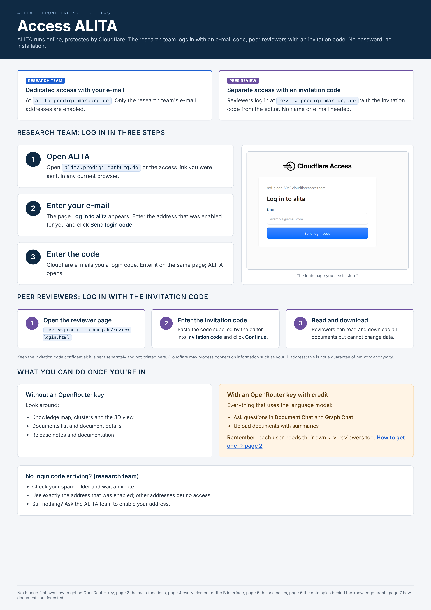
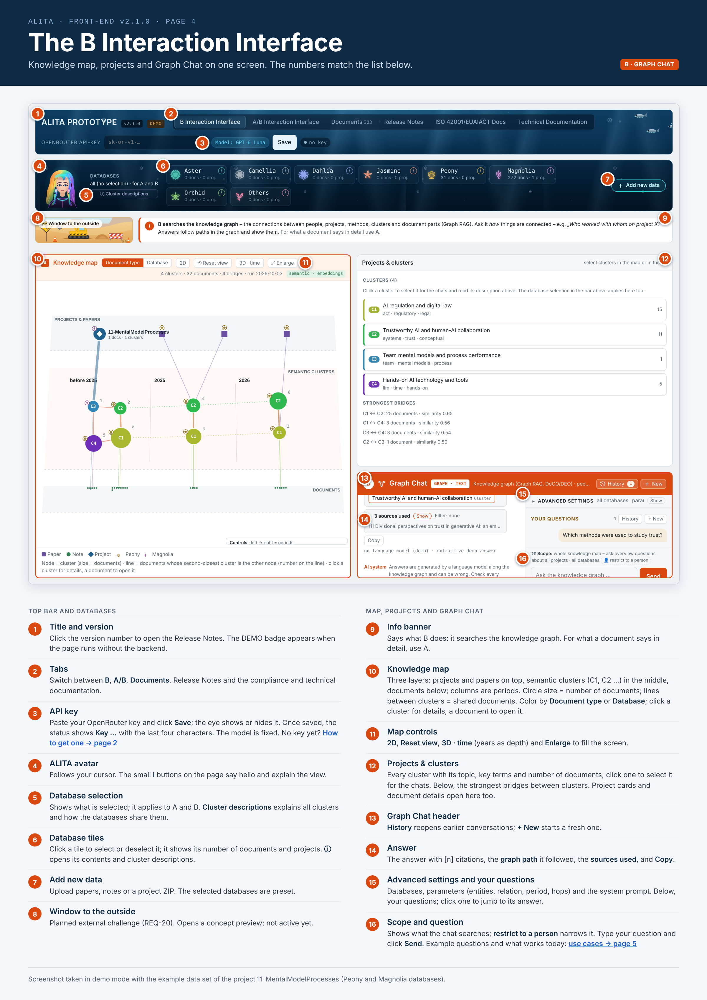
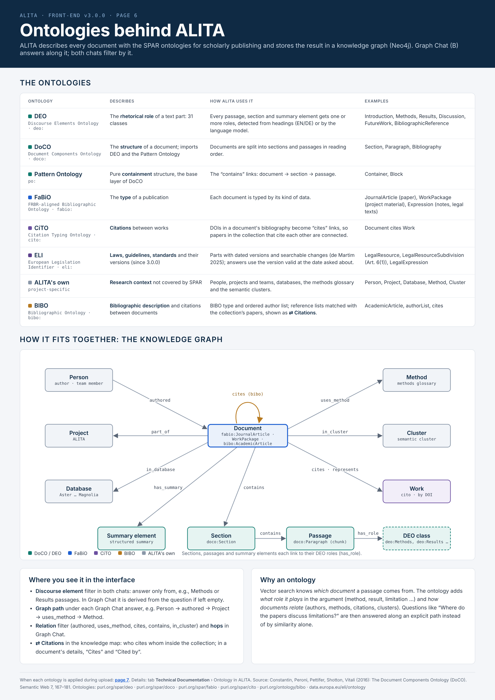
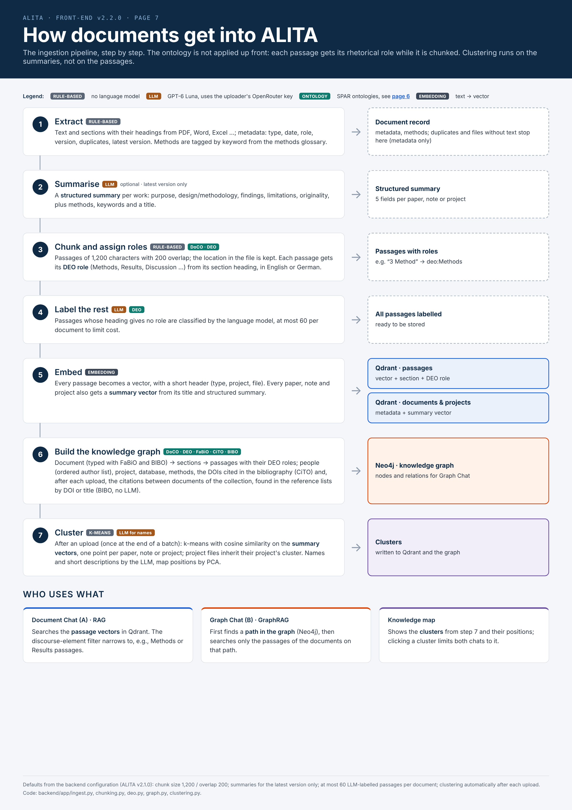

# ALITA – User Manual (front-end, v3.5.1)

ALITA lets you ask questions of your research documents and get answers with numbered, clickable sources.
The quick visual version is [`ALITA-Cheat-Sheet-Comic.pdf`](ALITA-Cheat-Sheet-Comic.pdf).

## Access ALITA

ALITA runs online, protected by Cloudflare. No password, no installation.

- **Research team:** dedicated access at `alita.prodigi-marburg.de`; only the research team's e-mail addresses are enabled.
- **Peer review:** separate access at `review.prodigi-marburg.de` with an invitation code from the editor; no name or e-mail needed.

**Research team – log in in three steps**

1. Open `alita.prodigi-marburg.de` or the access link you were sent.
2. The page **Log in to alita** appears. Enter the address that was enabled for you and click **Send login code**.
3. Cloudflare e-mails you a login code. Enter it on the same page; ALITA opens.

No code arriving? Check the spam folder, use exactly the enabled address, or ask the ALITA team to enable it.

**Peer reviewers – log in with the invitation code**

1. Open [review.prodigi-marburg.de/review-login.html](https://review.prodigi-marburg.de/review-login.html).
2. Paste the code supplied by the editor into **Invitation code** and click **Continue**.
3. Reviewers can read and download all documents but cannot change data.

Keep the invitation code confidential; it is sent separately and not printed in this manual. Cloudflare may process connection information such as your IP address; this is not a guarantee of network anonymity.

**Without an OpenRouter key** you can look around: knowledge map, clusters, 3D view, documents, release notes. **To ask questions or upload documents, every user – reviewers too – needs their own OpenRouter API key with credit**; see [Get an OpenRouter API key](#get-an-openrouter-api-key).

## Getting started

1. Log in as described in [Access ALITA](#access-alita).
2. Paste your **OpenRouter API key** (`sk-or-v1-…`) in the header and click **Save**. It stays in your browser. No key yet? See [Get an OpenRouter API key](#get-an-openrouter-api-key).
3. Pick one or more **databases** in the database bar (Aster, Camellia, Dahlia, Jasmine, Peony, Magnolia, Orchid, Others). No selection = all databases are searched.

## The tabs

| Tab | What you do there |
| --- | --- |
| **B Interaction Interface** | Full-width knowledge map on the left; **Projects & clusters** and Graph Chat on the right |
| **A/B Interaction Interface** | Document Chat and Graph Chat side by side, each with its cluster view above it |
| **Documents** | Browse, search, filter and upload files; open a document's details |
| **Release Notes** | What changed in each version (also via the version number in the header) |
| **ISO 42001/EUAIACT Docs** | Compliance documentation |
| **Technical Documentation** | Architecture and ontology reference |

The database bar stays visible on every chat page: **ⓘ Cluster descriptions** explains all clusters and **Clear selection** resets databases and clusters. New data is uploaded in **Documents → + Upload**.

## The B Interaction Interface

*Screenshot in demo mode with the example data set of the project 11-MentalModelProcesses.*

**Top bar and databases**

1. **Title and version:** click the version number to open the Release Notes. The DEMO badge appears when the page runs without the backend.
2. **Tabs:** switch between B, A/B, Documents, Release Notes and the compliance and technical documentation.
3. **API key:** paste your OpenRouter key and click **Save**; the eye shows or hides it. Once saved, the status shows **Key …** with the last four characters. The model is fixed.
   **Password:** without it only the database **EU AI Act** is shown. Enter the password you were given in the field **Password** next to the key and click **Save** to show all databases; **Lock** hides them again. The unlock is remembered in this browser only.
4. **ALITA avatar:** follows your cursor. The small **i** buttons on the page say hello and explain the view.
5. **Database selection:** shows what is selected; it applies to A and B. **Cluster descriptions** explains all clusters and how the databases share them.
6. **Database tiles:** click a tile to select or deselect it; it shows its number of documents and projects. **ⓘ** opens its contents and cluster descriptions.
7. **Upload:** papers, notes or a project ZIP are uploaded in **Documents → + Upload** (the database bar no longer has an upload button).
8. **Window to the outside:** planned external challenge (REQ-20). Opens a concept preview; not active yet.

**Map, projects and Graph Chat**

9. **Info banner:** says what B does: it searches the knowledge graph. For what a document says in detail, use A.
10. **Knowledge map:** all data in three layers: projects and papers on top, semantic clusters in the middle, documents below. Color by **Document type** or **Database**. Hover to preview, click to open.
11. **Map controls:** **2D**, **Reset view**, **3D · time** (years as depth), **⇄ Citations** (which papers cite each other) and **Enlarge** to fill the screen.
12. **Projects & clusters:** every cluster with its topic, key terms and number of documents; click one to select it for the chats. Below, the strongest bridges between clusters. Project cards and document details open here too.
13. **Graph Chat header:** **History** reopens earlier conversations; **+ New** starts a fresh one.
14. **Answer:** the answer with [n] citations, the **graph path** it followed, the **sources used**, and **Copy**.
15. **Advanced settings and your questions:** databases, parameters (entities, relation, period, hops) and the system prompt. Below, your questions; click one to jump to its answer.
16. **Scope and question:** shows what the chat searches; **restrict to a person** narrows it. Type your question and click **Send**.

## Document Chat (A) and Graph Chat (B)

**Where to find them:** the tab **A/B Interaction Interface** shows both chats side by side. The tab **B Interaction Interface** shows only Graph Chat (B), next to the knowledge map – so **Document Chat (A) is only visible on A/B**.

| | Document Chat (A) – RAG | Graph Chat (B) – GraphRAG |
| --- | --- | --- |
| Searches | the **text**: every document is cut into short passages; ALITA finds the passages closest in meaning to your question and writes the answer from them | the **connections**: on upload ALITA builds a knowledge graph of people, projects, methods, clusters and document parts, linked by relations such as *authored*, *uses_method* or *cites*; it starts at what your question names and follows these links |
| Best for | content, details, quotes, summaries – "what do the documents say?" | relationships – "who worked on what, which methods does a project use, who cites whom?" |
| Answer shows | the passages used, as [n] citations | the graph path it followed, plus the sources |

The knowledge graph behind Graph Chat is based on the SPAR ontologies DoCO, DEO, FaBiO and CiTO (see [Ontologies behind ALITA](#ontologies-behind-alita)); an ontology for bibliometrics (BIBO) is not implemented.

## Everyday tasks

**Ask your documents (Document Chat, A)**

1. Optionally narrow the scope under **Advanced settings**: Project / Paper / Notes, file type, method, cluster, discourse element (e.g. Methods, Results), year range, *latest versions only*.
2. Set how many **sources** to retrieve (1–15, default 6).
3. Type in *Ask your documents …* and click **Send**. The answer streams in with citations like [1].
4. Click a citation to jump to its source; expand **sources used** to see each passage. **Copy** copies the answer with its sources.

**Ask about relationships (Graph Chat, B)**

Use it for who-did-what questions: people, organizations, projects, methods. Filter by relation (authored, uses_method, cites, …) and period, and set **hops** (1–4, default 2) for how far the graph is followed. The answer shows the graph path it followed.

**Explore the cluster map**

- Hover a point for details, click it to open the document. Click a cluster to add it to both chats' search scope.
- **Compare databases** overlays the clusters of the selected databases; **⟲ Reset view** restores the start view; **⤢ Enlarge** fills the screen.
- **3D · time** walks through the clusters with years as depth: W/S or wheel = forward/back, A/D = sideways, Q/E = down/up, Shift = faster, drag = look, Esc = close. **▶ Fly through time** animates it.

**Laws, guidelines and standards (since 3.0.0)**

ALITA knows three more kinds of data: **Legal projects** (the versions of a law – proposal, adopted text, consolidated versions – plus accompanying documents, uploaded as one ZIP like a research project), **Legal guidelines**, **Standards** and – since 3.3.0 – **Guidance & FAQ** (Q&A pages, FAQs and factsheets of authorities, e.g. a page of the AI Office printed as PDF; split into topics and questions, cited as "Q 2.1"; filter chip "FAQ"). They appear as ▲ in the map and under *Documents → Laws, Guidelines & Standards*.

- Each text is split into its parts (articles, paragraphs, points, annexes; clauses for standards) and every part has dated versions. Answers use the **version valid at the time you ask about**: write the date into the question (*"What applied on 1 September 2026 to Annex III?"*, *"in 2025"*), a stage (*"in the Commission proposal"*) – or set **Legal texts as of** under *Advanced settings → Parameters*. Without a date ALITA uses today's version. The line **⏱ Legal texts** under the answer says which versions were used.
- Ask about changes (*"What changed in Article 50 since 2024?"*) or origins (*"Since when does the term 'general-purpose AI model' appear?"*): the answer shows a table from the change history (date, part, kind of change, amending act).
- In the document details of a version: stage, in force from–to, application date, the amending act, all versions of the norm and **Show the changes of this version**.
- Dates of entry into force and application come from a small file `_legal.yaml` in the folder (template in `research/EUAIA/legal/EU-AI-Act/`). Without it ALITA takes the file dates – then point-in-time answers are only as good as those dates. A version can consist of several files (e.g. a Commission proposal and its separate annexes): list them together, `file: [proposal.pdf, annexes.pdf]`.
- Some drafting documents contain only the amended parts – e.g. the compromise amendments of a Parliament committee. Mark such a version with `partial: true` in `_legal.yaml`; everything not in the document is then taken unchanged from the previous version instead of being counted as deleted, and the document details show "Scope: only the amended parts". Ask about this stage with words like *"in the IMCO/LIBE compromise amendments"* or *"im Ausschuss"*.
- An amending act (e.g. the Digital Omnibus on AI) contains instructions, not a full text. With `apply_amendments: <name of the amended act>` in `_legal.yaml` ALITA applies the instructions to the previous version and builds the consolidated version itself; the document details show how many instructions were applied and list those it could only apply approximately or not at all (later subparagraphs, points inside annexes). For exact work, check those against the consolidated text on EUR-Lex.
- Accompanying documents of a legal project (e.g. the Commission's White Paper that preceded a proposal) are listed under `documents:` in `_legal.yaml` with their role, date and title; they appear in the project with the role "White paper" at their date, before the versions of the law.
- If only drafts of a law are in the collection (e.g. just the Commission proposal), answers use the latest draft and say so ("no version in force …, showing the latest draft").

**See who cites whom (⇄ Citations)**

**⇄ Citations** in the header of the knowledge map switches the map to the citation network of the collection; click it again to go back.

- Each paper, note or project is a node: **left → right is the year**, the **size** shows how often it is cited inside the collection, shape and colour follow *Document type* / *Database* as in the map. Project files count as one node per project.
- An **arrow** points from the citing to the cited work. Solid = found by DOI or by title with first author; dashed = title only (less certain). Hover an arrow to see the entry in the reference list it came from.
- Click a node to highlight its citations and open it on the right; its details list **Cites** and **Cited by**. Drag to pan, wheel to zoom, **⟲ Reset view** to start again. The database selection applies.
- Papers without citations inside the collection sit in a strip at the bottom (checkbox *papers without citations*).
- ALITA finds the citations by itself after every upload, from the reference lists of the documents – no language model, no cost. **⟳ Recompute** does it again by hand (e.g. after an update). Only works *inside* the collection are linked; external literature is not looked up.
- Graph Chat answers citation questions from it, e.g. *"Which papers build on Heirati et al. 2024?"* or *"What is the most cited paper in Jasmine?"*.

**Add documents**

Click **Documents → + Upload**. Choose the database, the kind of data (Research project as ZIP, Research papers, Research notes, Legal project as ZIP, Legal guidelines, Standards), optionally a date and a project to link, and tick *Generate summary and methods with the LLM* if wanted. Check the summary screen and click **Upload**.

Uploading uses your OpenRouter key and credits (see [Get an OpenRouter API key](#get-an-openrouter-api-key)). **Cost:** about €0.003 per 10-page paper with the LLM summary (100 papers ≈ €0.30); without it, only embeddings, below €0.001. ALITA shows the actual cost after each upload. *Estimate: 10 pages ≈ 8,000 tokens of text; summary, section labelling and embeddings ≈ 25,000 tokens; GPT-6 Luna at $0.10 / $0.50 per 1M input / output tokens ([OpenRouter](https://openrouter.ai/openai/gpt-6-luna), Oct 2026).*

**Find a document**

On **Documents**, search by title, file name or path and filter by project, role, type, method, cluster and year. *Hide duplicates* and *latest version only* tidy the list; **Reset filters** clears it. A date marked ≈ comes from the file system and may be off.

## Settings and tips

- **Memory:** *use the conversation as memory* sends earlier turns with each question. Click **New** to start fresh.
- **History:** **History** reopens earlier chats, which are saved in this browser only. Download one or all as .txt.
- **System prompt:** the parameters button next to **New** opens the chat's system prompt for editing; **Reset to default** restores it.
- **Ask about one person:** click a 👤 name (or *restrict to a person*) to limit both chats to that person's papers, notes and project teams.
- **Prompt filters:** type `@db:Magnolia`, `@type:paper`, `@year:2019-2021`, `@method:survey` or `@cluster:3` in a question to filter inline.
- **No or weak answer?** Check that the API key is saved and the filters aren't too narrow; click **Clear selection** to widen the scope.
- ALITA's answers come from a language model and can be wrong. Check every statement against its sources.

## Get an OpenRouter API key

ALITA answers through OpenRouter, so every user needs their own key once.

1. **Create an account:** go to [openrouter.ai](https://openrouter.ai), click **Sign in** and sign up with Google, GitHub or e-mail.
2. **Add credits:** open [openrouter.ai/settings/credits](https://openrouter.ai/settings/credits) and buy credits (prepaid). **Starting with €5 is fine** – at about €0.003 per 10-page paper and well under one cent per question, that lasts for hundreds of questions and uploads. Payment by credit card, AliPay or USDC; card payments carry a 5.5% fee (at least $0.80). Unused credits can be refunded within 24 hours. ALITA uses a paid model; free models are limited to 50 requests per day without purchased credits.
3. **Create the key:** open [openrouter.ai/settings/keys](https://openrouter.ai/settings/keys), click **Create Key**, name it (e.g. `ALITA`) and set a credit limit (e.g. $10) or no limit. Copy the key right away: it starts with `sk-or-` and is shown only once.
4. **Paste it into ALITA:** paste it into **OpenRouter API-Key** in the top bar and click **Save**. The status changes from **no key** to **Key …** with the last four characters. The key is stored in this browser only.
5. **Keep it safe:** treat it like a password. If it leaks, delete it under [openrouter.ai/settings/keys](https://openrouter.ai/settings/keys) and create a new one; OpenRouter also e-mails you if it detects an exposed key.

Fees and limits as stated by OpenRouter in October 2026 ([FAQ](https://openrouter.ai/docs/faq), [Authentication](https://openrouter.ai/docs/api-reference/authentication)); they can change.

## Use cases for the research proposal

**Current scope of the prototype:** questions work **within one research project** (click the project in the map; both chats then answer about that project only). **Not yet:** dedicated comparisons between research clusters, or questions on paper level (one chosen paper or a set of papers). ALITA answers only from uploaded documents; external literature is outside the prototype.

| # | Use case | Typical question | Status today |
| --- | --- | --- | --- |
| 1 | Summarise own knowledge progress across projects | "How has my understanding of team mental models developed across my projects since 2015?" | **Partly** – knowledge stages per project, not across projects; own projects not uploaded yet (to be clarified with Michael) |
| 2 | Identify knowledge leaps and their reasons | "Where did my thinking change significantly between my early and my recent papers – and why?" | **Partly** – versions classified within a project; paper-level comparison not yet; comparison basis to define |
| 3 | Assess projects and plans against academic standards | "How well does this project plan meet the criteria for a sound research design?" | **Partly** – plans not submitted; standards (e.g. guidelines as PDF) can be built into the glossary |
| 4 | Explain how the analyses were done | "Explain to me how I did the analyses." | **Works** – within one project, from extracted methods and analysis files |
| 5 | Derive further research questions and loose ends | "What further research questions could be derived? Where are the loose ends?" | **Works** – within one project; not yet across clusters or for one paper |
| 6 | Find other uses for the data | "Can you do anything else with the data?" | **Works** – within one project; combining data across projects or clusters not yet |
| 7 | Uncover research gaps | "Which research gaps remain in the 11-MentalModelProcesses project?" | **Works** – tested; test results: [to be added] |
| 8 | State of knowledge from external sources | "What is the current state of research on trust in generative AI?" | **Not in prototype** – external sources excluded; planned as Window to the outside (REQ-20) |
| 9 | Assess own research ideas | "Here is my idea: … How strong is it, and how could I improve it?" | **Works** – paste the idea into the chat |
| 10 | Support in reaching knowledge leaps | "What more should I do with the data? Where do I need to look deeper?" | **Works** – upload the project, select it in the map, ask |

## Ontologies behind ALITA

ALITA describes every document with the SPAR ontologies for scholarly publishing and stores the result in a knowledge graph (Neo4j). Graph Chat (B) answers along it; both chats filter by it.

| Ontology | Describes | How ALITA uses it | Examples |
| --- | --- | --- | --- |
| DEO – Discourse Elements Ontology | rhetorical role of a text part (31 classes) | every passage, section and summary element gets one or more roles, from headings (EN/DE) or by the language model | Introduction, Methods, Results, Discussion, FutureWork |
| DoCO – Document Components Ontology | document structure; imports DEO and the Pattern Ontology | documents split into sections and passages in reading order | Section, Paragraph, Bibliography |
| Pattern Ontology | pure containment structure | the "contains" links document → section → passage | Container, Block |
| FaBiO | type of a publication | each document typed by its kind of data | JournalArticle (paper), WorkPackage (project material), Expression (notes, legal texts) |
| CiTO – Citation Typing Ontology | citations between works | DOIs in a bibliography become "cites" links | Document cites Work |
| ALITA's own | research context not covered by SPAR | people, projects and teams, databases, methods glossary, semantic clusters | Person, Project, Database, Method, Cluster |
| ELI – European Legislation Identifier, with the versioning model of de Martim (2025) | laws, guidelines and standards and their versions | every law, guideline and standard is split into its articles, paragraphs, points, annexes or clauses; each part has dated versions (unchanged parts are reused), every change is an *action* with its own searchable description – since 3.0.0 | LegalResource (norm), LegalResourceSubdivision (Art. 6(1)), LegalExpression (wording) |
| BIBO – Bibliographic Ontology | bibliographic description and citations between documents | every document gets its BIBO type and ordered author list; the reference lists are matched with the papers of the collection (DOI or title), giving "cites" links between documents and citation counts – the **⇄ Citations** view (since 2.2.0). Journals and impact metrics are not looked up | AcademicArticle, authorList, cites |

**In the interface:** the *Discourse element* filter in both chats, the *graph path* under each Graph Chat answer, the *Relation* filter and *hops* in Graph Chat, and **⇄ Citations** in the knowledge map with *Cites* / *Cited by* in the document details. Details: tab **Technical Documentation** › Ontology. Source: Constantin et al. (2016), The Document Components Ontology (DoCO), Semantic Web 7, 167–181.

## How documents get into ALITA (ingestion pipeline)

The ontology is not applied up front: each passage gets its rhetorical role while it is chunked. Clustering runs on the summaries, not on the passages.

| # | Step | How | Result |
| --- | --- | --- | --- |
| 1 | Extract | rule-based: text and sections with headings; metadata (type, date, role, version, duplicates, latest version); methods by keyword from the glossary | document record (duplicates and files without text stop here) |
| 2 | Summarise | LLM, optional, latest version only: purpose, design/methodology, findings, limitations, originality, plus methods, keywords, title | structured summary |
| 3 | Chunk and assign roles | rule-based: 1,200 characters, 200 overlap; DEO role from the section heading (EN/DE) – DoCO, DEO | passages with roles |
| 4 | Label the rest | LLM: passages without a role from their heading, at most 60 per document – DEO | all passages labelled |
| 5 | Embed | every passage (with a short header) becomes a vector; every paper, note and project gets a summary vector | Qdrant: passages (vector + section + DEO role); documents and projects (metadata + summary vector) |
| 6 | Build the knowledge graph | document typed with FaBiO and BIBO → sections → passages with DEO roles; people (ordered author list), project, database, methods, cited DOIs (CiTO); after each upload the citations between documents of the collection, found in the reference lists by DOI or title (BIBO, rule-based, no LLM) | Neo4j knowledge graph; `cites` / `cited_by` in Qdrant |
| 7 | Cluster | after each upload (once per batch): k-means (cosine) on the summary vectors, one point per paper, note or project; project files inherit; names and descriptions by the LLM, map positions by PCA | clusters in Qdrant and the graph |

**Who uses what:** Document Chat (A) searches the passage vectors (with the discourse-element filter); Graph Chat (B) first finds a path in the graph, then searches only the passages of the documents on that path; the knowledge map shows the clusters.

